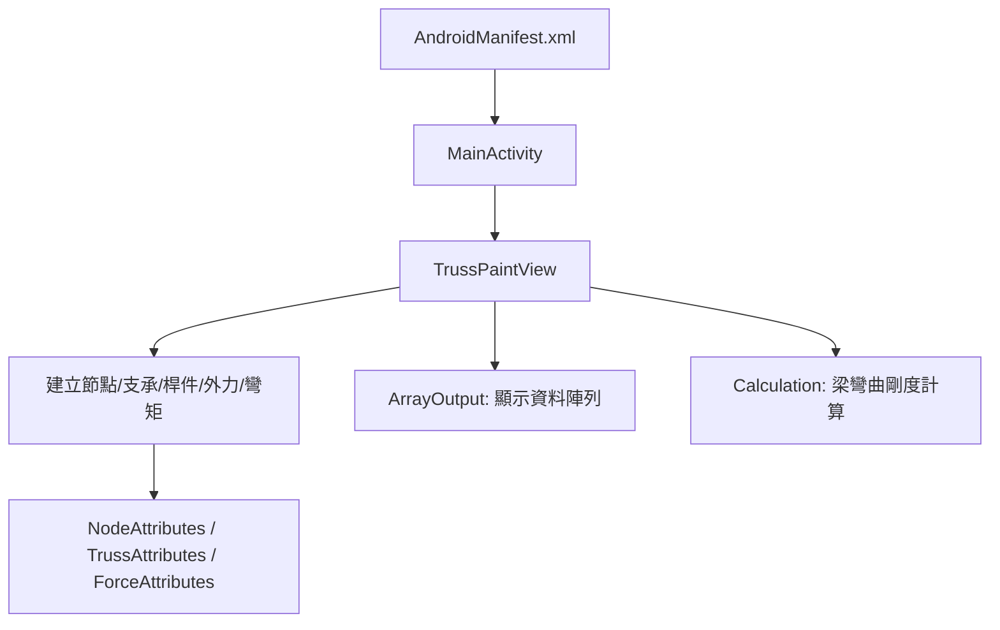

# Structure Analysis 專案內容報告

更新日期：2026-06-02

這份專案是一個以 Android Studio / Java 撰寫的結構分析 App 原型。原始目標是讓使用者在手機上建立節點、桿件、支承與外力，使用直接剛度法與 LU 分解求出結構受力結果，作為材料力學與結構分析作業的輔助工具。

目前倉庫保留了主程式、繪圖 View、計算程式、XML 介面片段、早期測試程式與一份成果報告 PDF。它比較像「歷史原始碼與資源片段」而不是可以直接開啟建置的完整 Android Studio 專案，因為缺少 `build.gradle`、`settings.gradle`、標準 `res/` 目錄、完整字串與 drawable/style 資源。

## 快速結論

- 主要啟動路徑是 `AndroidManifest.xml` 裡註冊的 `MainActivity` -> `TrussPaintView` -> `ArrayOutput` / `Calculation`。
- 使用者互動集中在 `TrussPaintView.java`：繪圖、觸控、資料儲存、選取、Bundle 輸出幾乎都在同一個類別。
- 目前 Manifest 接上的 `Calculation.java` 實際上是梁元素彎曲剛度計算，使用每個節點 2 個自由度：垂直位移與轉角。
- `TrussCaculation1.java` 是另一套未接入 Manifest 的 2D truss 軸力計算，含方向餘弦、EA/L 剛度矩陣與桿件內力。
- `BeamActivity.java`、`BeamCaculation1.java`、`TrussActivity.java` 看起來來自另一版較完整的分離梁/桁架介面，但引用了目前倉庫不存在的類別與資源。
- `report/大暑計畫成果報告.pdf` 是原專案書面報告，描述研究動機、Android Studio 選型、直接剛度法、LU 分解、App 使用流程、範例驗證、完成度與待完成項目。

## 專案目標與背景

成果報告中的專案目標是製作一個可以做結構分析的 Android App，服務對象是修習材料力學、結構分析的學生。當學生在網路上查找作業答案時，常會遇到答案不一致或解法錯誤的情況，因此本專案希望提供另一種可互動建模與計算的工具，降低比對答案與重算的時間成本。

原計畫使用 Android Studio 3.5 與 Java，介面參考 Android 自訂 View 教學，核心計算採用直接剛度法。矩陣求解部分自行實作 LU 分解、正向代入與反向代入。成果報告也提到計畫曾希望同時支援 Truss 與 Beam，並能呈現受力後變形、桿件內力、剪力與彎矩等結果。

## 目前檔案盤點

### 主路徑檔案

| 檔案 | 內容 |
| --- | --- |
| `AndroidManifest.xml` | App package 為 `com.example.Eric_app`，只註冊 `MainActivity`、`ArrayOutput`、`Calculation`。 |
| `MainActivity.java` | App 入口。載入 `activity_main.xml`，初始化 `TrussPaintView`，處理工具列選單。 |
| `TrussPaintView.java` | 核心 View。負責畫網格/座標軸、建立節點/桿件/支承/外力/彎矩、選取物件、儲存資料、Bundle 輸出與清除。 |
| `NodeAttributes.java` | 節點座標編輯對話框。 |
| `TrussAttributes.java` | 桿件材料參數編輯對話框，目前主要有 E 與 I 欄位。 |
| `ForceAttributes.java` | 外力大小與角度編輯對話框，會換算 Fx/Fy。 |
| `ArrayOutput.java` | 顯示節點、桿件、外力、支承資料。 |
| `Calculation.java` | Manifest 接上的計算頁，組裝梁彎曲剛度矩陣，求節點受力/力矩。 |
| `CanvasAidUtils.java`、`CanvasUtils.java` | 座標軸與線段繪製輔助工具。 |
| `activity_main.xml` | 全螢幕放置 `TrussPaintView`。 |
| `menu.xml` | 工具列選單：節點、支承、桿件、外力、彎矩、資料輸出、清除、計算。 |
| `activity_array_output.xml` | 四段 ScrollView 顯示模型資料。 |
| `activity_calculation.xml` | 兩段 ScrollView 顯示計算結果。 |
| `dialog_node.xml`、`dialog_truss.xml`、`dialog_force.xml` | 三種屬性編輯對話框。 |

### 重複與殘留檔案

| 檔案 | 內容 |
| --- | --- |
| `app/` 目錄 | 大多是根目錄檔案的另一份複本，另外有 `strings.xml`、`activity_truss.xml`、`truss.java`、`code`。 |
| `app/truss.java` | 固定 4 節點、6 桿件的 LU / truss prototype，package 是 `com.example.myapplication`，未接入目前 Manifest。 |
| `TrussActivity.java` | 未接入 Manifest 的桁架介面活動，引用 `NodeAttributes1`、`ForceAttributes1`、`RebuildMethod1` 等目前不存在的類別。 |
| `TrussCaculation1.java` | 未接入 Manifest 的標準 2D truss 直接剛度法計算。 |
| `BeamActivity.java` | 未接入 Manifest 的梁介面活動，引用 `BeamPaintView`、`MomentAttributes`、`RebuildMethod2` 等目前不存在的類別。 |
| `BeamCaculation1.java` | 未接入 Manifest 的梁彎曲計算，依賴目前不存在的 `BeamPaintView`。 |
| `ResultView.java` | 空白 View 類別，目前沒有實作內容。 |
| `clickmenu.xml` | 小型選單片段，目前未見接入主流程。 |
| `Beam` | 空檔案。 |
| `app/code` | 只有一行 `1`，應為測試或殘留檔。 |
| `report/大暑計畫成果報告.pdf` | 原始成果報告。 |
| `LICENSE` | MIT License。 |
| `.gitignore` | 標準 Android / IntelliJ 忽略規則。 |

## App 執行與互動流程

主畫面是一個全螢幕自訂 View。使用者透過 ActionBar 選單切換模式，每次選單動作會改寫 `TrussPaintView` 的 `OnTouchListener`，讓下一次點擊進入對應行為。

主要操作：

- `Dot`：點擊畫布建立節點。
- `Support`：在既有節點上建立 pin、vertical roller、horizontal roller、fix。
- `write`：選取節點並開啟座標編輯對話框。
- `truss`：依序點選兩個節點建立桿件，預設屬性為 E=200、A=10、I=10。
- `beam`：目前在 `MainActivity` 中不是建立 beam，而是選取既有桿件並開啟 `TrussAttributes` 修改材料屬性。
- `F`：在節點上建立外力，預設 Fx=10、Fy=0、angle=0。
- `M`：在節點上建立彎矩，預設 M=10。
- `Test`：選取外力並開啟 `ForceAttributes` 修改外力大小與角度。
- `Array`：把目前資料用 Bundle 傳到 `ArrayOutput` 顯示。
- `calculation`：把目前資料用 Bundle 傳到 `Calculation` 計算。
- `clear`：清除所有畫布與資料陣列。

## 核心資料模型

專案沒有獨立的 model 類別，所有模型資料都以 `ArrayList`、`Map<String, ArrayList>` 和 magic index 儲存在 `TrussPaintView`。

| 欄位 | 格式 | 說明 |
| --- | --- | --- |
| `nodearray1` | `[nodeIndex, x, y]` | 節點資料。`nodeIndex` 從 0 開始，x/y 是轉換後的數學座標。 |
| `nodearray2` | `[x, y]` | 節點座標備份，實際使用較少。 |
| `oriNodearray` | `[screenX, screenY]` | 畫布上的原始座標，用於繪圖與重畫。 |
| `element` | `[nodeA, nodeB]` | 桿件兩端節點 index。建立時會排序。 |
| `checkelement` | `[nodeB, nodeA]` | 用於檢查重複桿件。 |
| `attritrussarray` | `[E, A, I]` | 桿件屬性，預設 `[200, 10, 10]`。桁架計算用 E*A，梁計算用 E*I。 |
| `forcemap` | `nodeIndex -> [Fx, Fy, angle]` | 外力資料。節點建立時預設 `[0, 0, 0]`。 |
| `momentmap` | `nodeIndex -> [M]` | 彎矩資料。節點建立時預設 `[0]`。 |
| `supportmap` | `nodeIndex -> [xFree, yFree, rotFree]` | 支承自由度。`1` 代表可動，`0` 代表拘束。 |
| `nodepatharray` 等 Path 陣列 | `Path` | 實際繪圖形狀。 |
| `noderegionarray` 等 Region 陣列 | `Region` | 觸控命中判斷。 |

支承預設與自由度：

| 支承 | 儲存值 | 意義 |
| --- | --- | --- |
| 無支承 | `[1, 1, 1]` | x、y、轉角皆可動。 |
| Pin | `[0, 0, 1]` | x/y 拘束，轉角可動。 |
| Horizontal roller | `[1, 0, 1]` | x 可動，y 拘束，轉角可動。 |
| Vertical roller | `[0, 1, 1]` | x 拘束，y 可動，轉角可動。 |
| Fix | `[0, 0, 0]` | x/y/轉角皆拘束。 |

## 繪圖與座標系

`TrussPaintView` 的畫布設計重點：

- 使用 `Bitmap` + `Canvas` 作為持久畫布，`onDraw` 每次先畫背景座標與網格，再把 bitmap 畫回 View。
- 使用 `canvas.translate(fwidth / 2, fheight / 2)` 與 `canvas.scale(1, -1)` 把座標原點移到畫面中心，並讓 y 軸朝上。
- 網格間距預設為 100 px。
- 節點為藍色圓點，選取時變綠；桿件黑色，外力紅色，支承深藍色。
- 每個可選物件都有對應 `Path` 與 `Region`，點擊時用 `FindNodeRegionIndex`、`FindTrussRegionIndex`、`FindForceRegionIndex` 尋找命中的物件。
- 節點文字與桿件文字會直接畫在 bitmap 上；修改節點時只局部清除舊節點與編號。

## 計算核心

### `Calculation.java`：目前主流程接上的計算

`Calculation` 從 Intent 取得：

- `nodes2`
- `elements2`
- `forces2`
- `supports2`
- `attritruss`
- `moment`

計算步驟：

1. 從桿件列表收集實際有被桿件使用到的節點 `checkn`。
2. 建立節點座標矩陣 `Coordinate` 與桿件連接矩陣 `Information`。
3. 依支承資料建立 `PointFreedom`，此處使用 `supportmap` 的第 1、2 格，也就是 y 位移與轉角自由度。
4. 建立外力/彎矩向量 `FM`，y 位移自由度取 `Fy`，轉角自由度取 `M`。
5. 對每支桿件計算長度 L 與 `EI = E * I`。
6. 組裝 Euler-Bernoulli 梁元素 4x4 彎曲剛度到全域 K：
   - `12EI/L^3`
   - `6EI/L^2`
   - `4EI/L`
   - `2EI/L`
   - 對應正負號填入兩端節點的 y / rotation 自由度。
7. 依可動自由度建立縮減矩陣 `K2`。
8. 用自行實作的 LU 分解解 `K2 * d = FM`。
9. 把可動自由度位移 `d` 填回完整位移向量 `D`，拘束自由度填 0。
10. 計算 `Q = K * D`。
11. 在畫面顯示每個節點的 `Y` 與 `M`。

注意：此檔案中的桿件內力計算段落目前被註解，因此 `activity_calculation.xml` 的第二個結果區塊實際上不會顯示內力。

### `TrussCaculation1.java`：未接入的 2D truss 計算

這份檔案是標準平面桁架直接剛度法：

- 每個節點 2 個自由度：x、y 位移。
- 每支桿件計算 L、cos、sin。
- 使用 `EA/L` 組裝 4x4 軸向剛度矩陣到全域 K。
- 依可動自由度建立 `K2`，並處理預位移陣列 `Dp` 的預留邏輯。
- 使用 LU 解位移向量 D。
- 計算 `Q = K * D`，並對拘束自由度扣除既有外力作為反力。
- 以桿件方向向量與兩端位移求軸向內力 `EA * delta / L`。
- 最後把節點座標依位移放大 10 倍更新，準備重畫變形圖。

這份檔案比目前接上的 `Calculation.java` 更接近成果報告中「Truss 直接剛度法」的描述，但它沒有出現在 Manifest 的可執行路徑。

### `BeamCaculation1.java`：未接入的梁計算

這份檔案與 `Calculation.java` 很像，都是梁元素彎曲剛度矩陣：

- 每個節點 2 個自由度：垂直位移與轉角。
- 使用 `EI`、L 組裝梁元素剛度矩陣。
- 解出 D 後計算 Q。
- 對拘束自由度有額外扣除外力/彎矩的反力修正。
- 會把節點垂直位移依比例更新到 `BeamPaintView`。

問題是它依賴 `BeamPaintView`，而目前倉庫沒有這個類別，因此不能直接編譯。

### LU 分解

`Calculation.java`、`TrussCaculation1.java`、`BeamCaculation1.java`、`app/truss.java` 都有類似的 LU 實作：

- 將 A 分解成 L 與 U。
- L 的對角線設為 1。
- 先用 forward substitution 解 `L * Y = B`。
- 再用 backward substitution 解 `U * X = Y`。

限制：

- 使用 `float`，精度有限。
- 沒有 pivoting，遇到奇異矩陣、接近奇異矩陣或主元為 0 時容易出現 `NaN` / `Infinity`。
- 沒有統一錯誤處理，部分檔案用 `Float.isNaN` 或 `ArrayIndexOutOfBoundsException` 判斷不可計算。

## 原成果報告重點

PDF 報告雖然文字抽取有缺字，但可辨識出以下內容：

- 研究動機：希望降低學生查找錯誤答案、重複驗算與比對答案的時間成本。
- 開發工具評估：比較 Google App Maker、Eclipse、Android Studio、Xcode，最後選擇 Android Studio + Java。
- 理論基礎：矩陣基本性質、直接剛度法、LU 分解。
- Android 介面：自訂 View、`OnTouchListener`、Canvas / Bitmap、座標轉換、ArrayList 資料結構、物件選取與重畫。
- App 使用流程：建立節點、桿件、支承、外力，修改屬性，按下計算並顯示結果。
- 範例驗證：使用 Hibbeler 結構分析教材中的 Truss 與 Beam 範例，將 App 結果與手算/程式解比較。
- 完成度自評：程式計算約 60%，介面約 80%，整體約 70%。
- 待完成項目：分布力、預位移、牛頓法求值、更多支承類型、多餘桿件判斷、Truss/Beam 合併、平移縮放、復原、輸出數值到折線圖、剪力/彎矩圖與更完整的材料屬性修改。

## 已知問題與重構風險

1. **不是完整可建置專案**：缺少 Gradle 檔、標準 Android resource 目錄、完整 drawable/style/string 資源。
2. **根目錄與 `app/` 有大量重複檔案**：需要先決定 source of truth。
3. **資源引用不完整**：`menu.xml` 參照很多 `@string`、`@drawable`、`@style`，但目前只看到少量資源定義。
4. **未接入檔案引用缺失類別**：`BeamActivity`、`TrussActivity` 依賴多個不存在的 View、Attributes、Rebuild 類別。
5. **package 不一致**：`app/truss.java` 是 `com.example.myapplication`，與主專案 `com.example.Eric_app` 不同。
6. **命名錯字與歷史殘留**：`Caculation`、`Horzintal` 等拼字錯誤會增加重構成本。
7. **`TrussPaintView` 職責過大**：同時處理 UI、資料模型、繪圖、觸控、序列化與部分狀態管理。
8. **大量 static 狀態**：View、Paint、Canvas、Path、資料陣列多為 static，容易受 Activity lifecycle、重新進入、旋轉畫面與多 View 實例影響。
9. **資料格式靠 magic index**：例如 `[E, A, I]`、`[Fx, Fy, angle]`、`[xFree, yFree, rotFree]`，重構時很容易寫錯 index。
10. **`MainActivity` 選取邏輯不可靠**：多處先呼叫 `selectnode()` / `selecttruss()` / `selectforce()` 設定 listener，又立刻用回傳值判斷是否開 dialog；實際選取是非同步觸控事件，容易和預期不同。
11. **節點修改沒有完整重建依賴物件**：修改節點座標只重畫節點，與該節點連接的桿件、支承、外力圖形與 hit region 不一定同步。
12. **`NodeAttributes` 判斷條件可疑**：目前 `setX == oldx || setY == oldy` 就視為沒有修改，代表只改單一座標時可能不更新。
13. **`TrussAttributes` 寫入錯位**：對話框顯示 E 與 I，但儲存時把 I 寫到 `attritrussarray[1]`，而梁計算讀的是 `attritrussarray[2]`；`setArea` 也沒有實際輸入。
14. **支承繪圖 region 可疑**：部分 roller 的 region 使用空的 `Roller_p`，pin 使用全域 `Pin_p`，可能導致選取或清除狀態累積錯誤。
15. **外力/彎矩屬性修改不重畫圖形**：資料有更新，但箭頭文字與圖形不一定同步。
16. **計算假設節點 index 連續且從 0 開始**：`checkn` 壓縮了節點集合，但後續 `Information` 仍用原 node index 存取 `Coordinate`，若模型跳過某些節點可能越界或取錯座標。
17. **`Calculation.java` 反力處理不完整**：不同於 `BeamCaculation1`，目前主流程的 `Calculation` 沒有對拘束自由度扣除既有外力/彎矩。
18. **沒有輸入驗證**：空模型、無支承、零長度桿件、重複外力、奇異矩陣、單位不一致都沒有完整防呆。
19. **單位顯示不一致**：外力文字顯示 N，結果顯示 kN，彎矩顯示 N*m。
20. **沒有測試**：計算核心沒有單元測試，重構前需要用報告中的範例建立回歸測試。

## 建議的重構順序

1. **恢復可建置專案骨架**：建立標準 Android Studio / Gradle 結構，補齊 resources，確認哪一份 Java/XML 是主版本。
2. **分離資料模型**：建立 `Node`、`Element`、`Support`、`Load`、`Moment`、`SectionProperty` 等類別，移除 magic index。
3. **分離 solver**：把 truss solver 與 beam solver 從 Activity/View 拆成純 Java 類別，輸入模型、輸出位移/反力/內力。
4. **補測試**：先用成果報告中的 Truss / Beam 範例建立測試，確認重構前後數值一致。
5. **改善矩陣求解**：至少改用 `double` 與 partial pivoting；若允許依賴，可考慮成熟線性代數函式庫。
6. **重寫 View 狀態流**：View 只根據 model 重畫，不直接持有 static 全域資料；節點修改後整體重建 Paths/Regions。
7. **明確分開 Truss 與 Beam**：兩者自由度、支承意義、元素剛度不同，應有不同 solver 與 UI 模式。
8. **統一單位與輸出格式**：明確定義長度、力、彎矩、E/A/I 的單位，結果顯示與輸入一致。
9. **補使用者防呆**：檢查模型是否穩定、支承是否足夠、矩陣是否可解、桿件是否重複或零長度。
10. **整理歷史檔案**：把 prototype、報告、舊版活動與殘留檔移到 `archive/` 或 `docs/`，降低維護干擾。

## 複習重點

如果之後要快速複習這個專案，建議按以下順序看：

1. 看 `MainActivity.java`：理解選單如何切換模式與如何進入資料輸出/計算頁。
2. 看 `TrussPaintView.java`：理解資料如何建立、儲存、繪圖與打包。
3. 看 `Calculation.java`：理解目前可執行路徑中的梁彎曲矩陣計算。
4. 看 `TrussCaculation1.java`：理解原本想做的標準 2D truss 直接剛度法。
5. 看 XML：理解畫面其實很薄，大部分 UI 行為都在 Java 裡動態產生。
6. 看 PDF 報告：回顧原始研究動機、理論推導、App 使用流程與完成度自評。

## 授權

本專案使用 MIT License，詳見 `LICENSE`。
